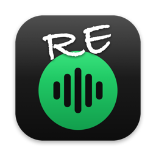
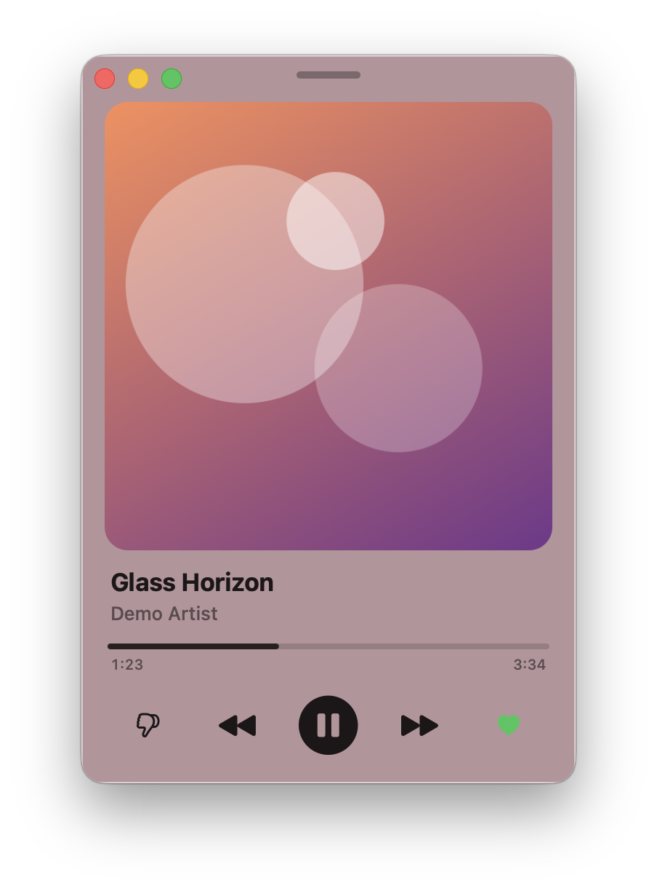
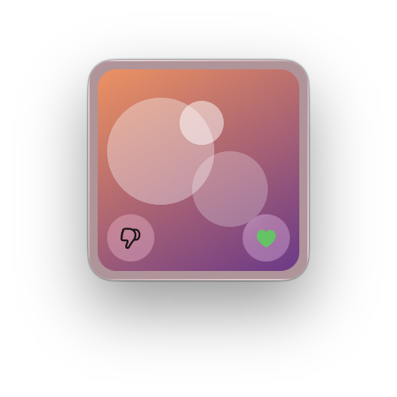

<p align="center"></p>

<h1 align="center">ReMini</h1>

<p align="center">A small, native macOS glass mini player for the Spotify web player.</p>

> **Unofficial.** This is a personal project. It is not affiliated with, endorsed by, or connected to Spotify AB.
> "Spotify" is a trademark of Spotify AB. You need your own Spotify account, and use is subject to Spotify's Terms of Use.

<p align="center">
  
  &nbsp;&nbsp;
  
</p>
<p align="center"><sub>Mini and Tiny modes. Screenshots use a made-up demo track and cover.</sub></p>

## Motivation

On my work machine, company policy blocks the Spotify desktop app. The web player works, but it lives in a browser tab that is always buried under a pile of other windows and tabs. Just pausing a song or seeing what's playing means digging for that tab.

So ReMini wraps the web player in a small, native macOS window that stays on top. It shows what's playing in the menu bar and gives you play, skip, and save without hunting for a tab. When you need to search or browse, it expands to the full web player.

## Features

- **Three sizes.** Switch with <kbd>⌘1</kbd> / <kbd>⌘2</kbd> / <kbd>⌘3</kbd>, the View menu, or the menu bar menu:
  - **Tiny** (140×140): only the cover. Click it to play or pause. Dislike and + (save) float in the corners.
  - **Mini** (340×500): cover, title, artist, progress, and controls (👎 ⏮ ⏯ ⏭ +).
  - **Full**: the complete Spotify web player for browsing, search, and playlists. It can be resized and remembers its size.
- **Liquid Glass look.** It uses `NSGlassEffectView`, and the glass is tinted with the average colour of the current cover.
- **Menu bar item.**
  - The bar shows the current track. Long titles scroll smoothly.
  - Its menu works like Control Center's Now Playing: cover, title, artist, and a row of buttons (👎 ⏮ ⏯ ⏭ +). The buttons act without closing the menu.
- **Standard window.** It has normal close, minimize, and zoom buttons (green toggles Mini ↔ Full) and floats above other windows.
  - **Close** hides the window and the music keeps playing. Bring it back with the Dock icon or **Show Player**.
- **Smart resizing.** When you switch sizes, the window grows away from the nearer screen edges. Switching back puts it exactly where it was.
- **Content zoom** for the full player: <kbd>⌘=</kbd> / <kbd>⌘−</kbd> / <kbd>⌘0</kbd>. The zoom is remembered.
- **Standard login.** You log in on Spotify's own login page, and the session persists between launches.

## Requirements

- macOS 26 (Tahoe) or later, because the app uses `NSGlassEffectView`.
- Xcode Command Line Tools for `swiftc`. You don't need an Xcode project.
- A Spotify account. Free works, Premium removes ads.

## Saving tracks (+)

The + button works out of the box. It clicks the web player's own button and saves the current track to **Liked Songs**. A saved track shows a green ✓. If you click ✓, Spotify opens its "add to playlist" dialog, where you can remove the track or pick other playlists, so ReMini switches to Full mode for it.

### Optional: a separate "Liked from ReMini" playlist

If you want + to save to a private playlist **Liked from ReMini** instead, connect your own free Spotify app. ReMini creates the playlist the first time you use it. Clicking ✓ removes the track again, without opening the dialog. This uses the official Spotify Web API, not the web player's buttons.

1. Open the [Spotify Developer Dashboard](https://developer.spotify.com/dashboard) and create an app.
2. Add the Redirect URI `http://127.0.0.1:43821/callback`.
3. Tick **Web API** and save.
4. In ReMini, choose **Save to Liked from ReMini (own Spotify app)…** from the menu bar menu, and paste the app's **Client ID**.
5. A small window asks you to allow access. You are usually logged in already, because it shares cookies with the player.

How the connection works:

- It uses Authorization Code with PKCE, so no client secret is stored anywhere.
- The refresh token is kept in the macOS Keychain.
- **Disconnect Spotify API** goes back to Liked Songs.
- The app asks only for these scopes: reading the current track, reading your playlists, and changing your playlists.

New Spotify apps run in *development mode*, which only works for the accounts listed under **User Management** in the dashboard. That includes your own account. This is why every user connects their own app: a shared app would need every user added by hand, and Spotify only lifts that limit for large companies.

## Download

Prebuilt builds are attached to every [GitHub Release](../../releases) as `ReMini-<version>-macos-arm64.zip`, with a `.sha256` checksum next to them.

```sh
gh release download --repo twarr58/re-mini --pattern 'ReMini-*.zip*'
```

### Gatekeeper and the quarantine attribute

Builds are only **ad-hoc signed**. They are not signed with an Apple Developer ID and not notarized. When you download a file with a browser, macOS adds the `com.apple.quarantine` extended attribute to it, and the unzipped app inherits it. Gatekeeper then refuses to open the app and says it "is damaged" or "can't be checked for malicious software".

Check the checksum, then remove the attribute once:

```sh
shasum -a 256 -c ReMini-*.zip.sha256
unzip ReMini-*.zip
xattr -dr com.apple.quarantine ReMini.app
```

- `xattr -l ReMini.app` shows the attributes the app has now.
- `-d` deletes the attribute and `-r` does it for every file inside the bundle.
- Removing the attribute only skips the Gatekeeper check for this copy. It does not turn off Gatekeeper.
- Instead of `xattr` you can try to open the app, then go to **System Settings → Privacy & Security** and click **Open Anyway**.
- Files fetched with `curl` or `gh release download` usually get no quarantine attribute. Apps you build yourself never get one.

## Build & run

```sh
make          # build and ad-hoc sign ReMini.app
make run      # build and open it
```

The `Makefile` compiles `main.swift`, `Logic.swift` and `SpotifyAPI.swift`, creates the `.app` bundle from `Info.plist.in`, and ad-hoc signs it. It only rebuilds what changed.

| Target | What it does |
|---|---|
| `make` / `make app` | Build and sign `ReMini.app` |
| `make run` | Build and open the app |
| `make test` | Run the unit tests (`Tests/main.swift`) |
| `make check` | Check the built bundle: plist lint, linked frameworks, `codesign --verify` |
| `make zip` | Package the app as a zip with a `.sha256` (uses `ditto`, so the signature survives) |
| `make install` | Copy the app to `/Applications` (change with `PREFIX=...`) |
| `make uninstall` | Remove it from `/Applications` |
| `make icon` | Regenerate `AppIcon.icns` (`make icon BASE=base.png` draws the "RE" over your own image) |
| `make clean` | Remove build outputs |
| `make help` | List targets |

Variables: `VERSION` and `BUILD` set the version in `Info.plist` (`make VERSION=1.2.0`), and `SIGN_ID` picks a signing identity instead of the ad-hoc `-`.

## CI/CD and releases

The version is stored in the `VERSION` file. The Makefile reads it, and [release-please](https://github.com/googleapis/release-please) updates it, so you never edit it by hand.

- **`ci.yml`, Build, Test & Publish.** It runs on pushes to `main`, on pull requests, and on `v*` tags.
  1. **Build** on `macos-26`: `make test` (unit tests), `make app`, `make check`, `make zip`. Builds that are not releases get versions like `0.1.0-dev.42+abc1234`.
  2. **Test** the zipped artifact: checksum, bundle layout, `Info.plist`, code signature, and a launch smoke test.
  3. **Publish** (release tags only): attaches the zip and its checksum to the GitHub Release. The build fails if the tag does not match `VERSION`.
- **`release-please.yml`.** On every push to `main` it opens or updates a *release PR*. That PR bumps `VERSION` and updates `CHANGELOG.md` based on [Conventional Commits](https://www.conventionalcommits.org/):
  - `fix:` → patch
  - `feat:` → minor
  - `feat!:` or `BREAKING CHANGE:` → major (while the version is below 1.0, these bump the minor version instead)

  When you merge the release PR, release-please tags `ReMini-vX.Y.Z`, creates the GitHub Release, and starts `ci.yml` for that tag.

  To build and publish an existing release again, run *Build, Test & Publish* by hand (*Actions → Run workflow*) and set **tag**, for example `ReMini-v0.1.0`.

### Commit messages

Commits follow [Conventional Commits](https://www.conventionalcommits.org/), because release-please reads them to pick the next version:

```
<type>[optional scope][!]: <lowercase description>
```

The allowed types are `feat`, `fix`, `perf`, `refactor`, `revert`, `docs`, `style`, `test`, `build`, `ci` and `chore`. Here are three examples:

```
feat: add seek in mini mode
fix(bridge): update like-button selector
feat!: require macOS 26.1
```

The `conventional-commits.yml` workflow checks every PR. It checks the **PR title**, because squash merge uses it as the commit message on `main`. It also checks **each commit** in the PR with commitlint (`.commitlintrc.json`).

These are also set up or recommended:

- **Branch protection** (recommended): require the *PR title* and *Commit messages* checks before merging into `main`.
- **Dependabot** keeps the GitHub Actions in the workflows up to date.
- **Repository setting needed once:** *Settings → Actions → General → Allow GitHub Actions to create and approve pull requests*. Without it, release-please cannot open its PR.

## Keyboard shortcuts

| Shortcut | Action |
|---|---|
| <kbd>⌘1</kbd> / <kbd>⌘2</kbd> / <kbd>⌘3</kbd> | Tiny / Mini / Full |
| <kbd>⌘=</kbd> / <kbd>⌘−</kbd> / <kbd>⌘0</kbd> | Zoom in / out / reset, in the full player |
| <kbd>⌘R</kbd> | Reload the web player |
| <kbd>⌘M</kbd> / <kbd>⌘W</kbd> / <kbd>⌘Q</kbd> | Minimize / close (playback continues) / quit |

On keyboard layouts without digits on the top row, macOS shows these shortcuts with that layout's characters. On a Czech layout, for example, ⌘1/2/3 appear as ⌘+ / ⌘ě / ⌘š. The physical keys are the same.

## How it works

The app is a single Swift file (`main.swift`) with no third-party dependencies.

- **Playback engine.** A `WKWebView` runs `open.spotify.com`. In Tiny and Mini modes it stays in the window with `alphaValue = 0`, not `isHidden`. WebKit suspends hidden views, and that would stall playback.
- **Now-playing bridge.** A small injected script checks the page once a second and reports to the app only when something changes.
  - Title, artist, and cover come from `navigator.mediaSession`, with the player bar as a fallback while paused.
  - Progress and the saved (+) state come from the player's `data-testid` attributes.
- **Controls.** The native buttons click the real buttons in the web player, so queue, shuffle, and Spotify Connect behave as they do in a browser.
- **+ (save).** By default, it clicks the player's own save button. With your own Spotify app connected, it uses the Spotify Web API (`SpotifyAPI.swift`) to add the track to, or remove it from, the ReMini playlist. See [Saving tracks](#saving-tracks-).

## Known limitations

- **Selectors can break.** The app depends on Spotify's web player DOM (`data-testid`). If Spotify renames those attributes, some controls stop working until the selectors in `bridgeJS` and `click(...)` are updated.
- **Dislike = skip.** Spotify has no general "dislike" for tracks, so 👎 skips to the next one.
- **+ in Liked Songs mode** depends on the player's button (`data-testid`), like the other controls.
- **+ in playlist mode** works only for music tracks. Podcast episodes are not saved.
- **No seeking** from the progress bar in Mini mode.
- **Browser identity.** The web player reports itself as Safari through its user agent.

## Files

| File | Purpose |
|---|---|
| `main.swift` | The app: windows, web view, menus |
| `Logic.swift` | Pure helpers (time format, window anchoring, cover colour, OAuth/PKCE) shared with the tests |
| `SpotifyAPI.swift` | Web API client for the + button: login, Keychain, playlist |
| `Tests/main.swift` | Unit tests, run with `make test` |
| `Makefile` | Build, package, and install targets |
| `Info.plist.in` | `Info.plist` template |
| `VERSION` | Current version (managed by release-please) |
| `make-icon.swift` | Renders `AppIcon.icns` |
| `AppIcon.icns` | App icon (original artwork) |
| `docs/` | README images |
| `TODO.md` | Planned work (Homebrew cask, notarization, …) |
| `.github/` | Workflows and Dependabot config |
| `.commitlintrc.json` | Commit message rules |
| `release-please-config.json`, `.release-please-manifest.json` | release-please setup |
